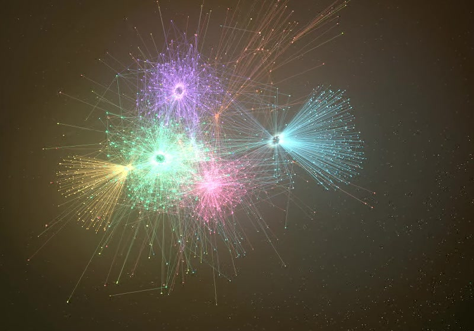
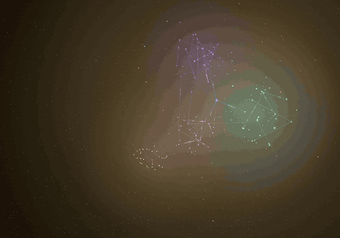
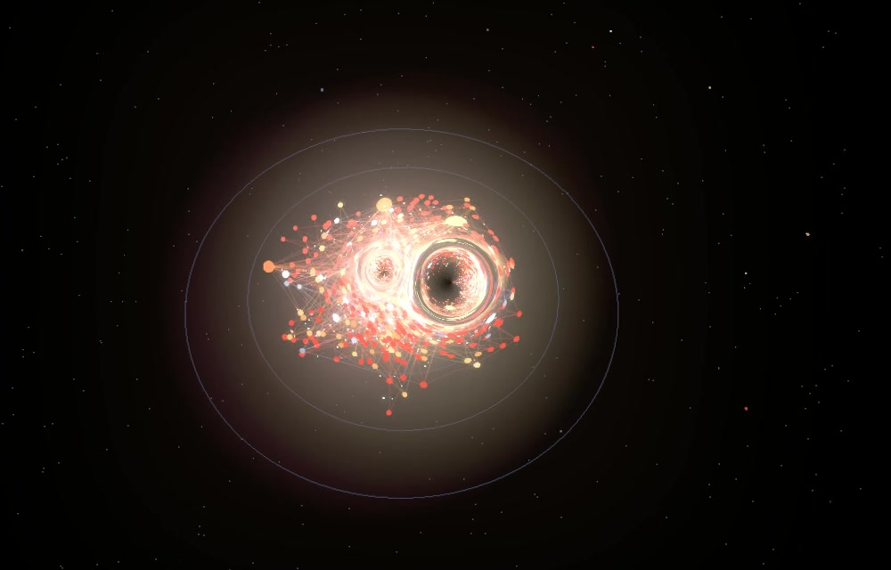
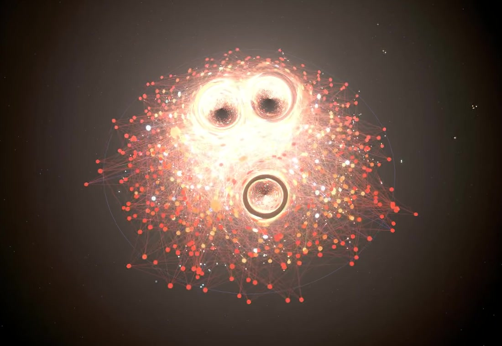

# Stellar Graph 3D

A 3D graph view for [Obsidian](https://obsidian.md) that looks like a galaxy. Notes are stars, links are comets' paths, folders are nebulae.

<a href="https://buymeacoffee.com/thor040175"></a>



Time travel: watch the vault grow note by note, from the first note to today.



The biggest hubs turn into black holes with an accretion disk and gravitational lensing. Folders appear as nebulae in their own colors.



Galaxy mode (expansion layout with age colors): the oldest notes sit outside in red, the freshest ones glow in the core.



*All images show a fictional demo vault.*

## Features

**Look**
- Glowing stars sized by link count, star dust, folder nebulae that clear when you zoom in
- Comets running along links, shooting stars, black holes with an accretion disk and gravitational lensing for the biggest hubs
- Recently edited notes pulse, unlinked notes drift on the outer rim

**Navigation**
- Search with fly-to, focus mode, hover cards with a preview, minimap
- Clickable legend: filter folders, pick your own folder colors
- Route: shortest link path between two notes
- Constellations: type `#tag` in the search to draw a tag as a constellation
- Cinema mode: an automatic camera tour without any controls

**Time and shape**
- Time travel: watch your vault grow note by note, with adjustable speed
- Age colors (fresh = blue-white, dusty = red) and an expansion layout (oldest notes outside, freshest in the core)
- Spiral mode: flattens the graph into a rotating spiral galaxy with tilt and spin sliders

**Living vault**
- Live updates: new notes appear as new stars, edits flash, deleted notes fade out in a small supernova
- Dark matter: links to notes that do not exist yet appear as violet ghost points. Click one to create the note
- Moons: open tasks (`- [ ]`) orbit their note. Planets: linked attachments such as images and PDFs
- Photo (PNG) and video (WebM) capture, including a one-click time travel timelapse
- Optional soft ambient sound

Click a button's tooltip or press `?` in the graph for a quick guide.

## Installation

Not yet in the community plugin list. Manual installation:

1. Download `main.js`, `manifest.json` and `styles.css` from the latest release.
2. Put them in `<your vault>/.obsidian/plugins/stellar-graph-3d/`.
3. Reload Obsidian and enable **Stellar Graph 3D** under *Settings → Community plugins*.
4. Open the graph from the ribbon icon or the command **Open 3D graph**.

Desktop only (it needs WebGL).

## Settings

Language, start view, spin direction, color palette (including a color-blind safe one), age measure, hidden folders, pulse period, glow, nebula opacity, comet count, black hole threshold, time travel duration, and switches for the extra effects, performance mode, automatic throttling, a dense bright core for expansion layout and sound. The ⚙ button in the graph opens them directly.

## Performance

Everything runs locally in your vault. Vaults with a few thousand notes run smoothly on a desktop GPU (a fictional test vault with about 2,600 notes stayed above 60 frames per second, one with about 4,800 notes above 35). On slower machines turn on *Performance mode*, or leave *Throttle effects automatically* on: the plugin lowers its effects when the frame rate stays low. *Show frame rate* in the settings displays the current numbers.

## Privacy

Stellar Graph 3D makes no network requests and collects no data. It stores your view (camera, selected folders, colors) in the app's local storage and your settings in the plugin's `data.json`. Photos and videos are saved to your Downloads folder only when you press the buttons.

## Development

```bash
npm install
npm run build        # writes main.js into the project folder
# optional: copy into a vault after each build
STELLAR_GRAPH_VAULT="/path/to/vault" npm run dev
```

Built with TypeScript, [three.js](https://threejs.org) and [d3-force-3d](https://github.com/vasturiano/d3-force-3d).

## Support

Stellar Graph 3D is free and open source. If it makes exploring your notes more fun, you can [buy me a coffee](https://buymeacoffee.com/thor040175). Thank you!

## Credits and licenses

- three.js, MIT License
- d3-force-3d, MIT License
- This plugin was created with the help of an AI assistant (Claude by Anthropic) and directed and tested by a human author.

Released under the [MIT License](LICENSE).
